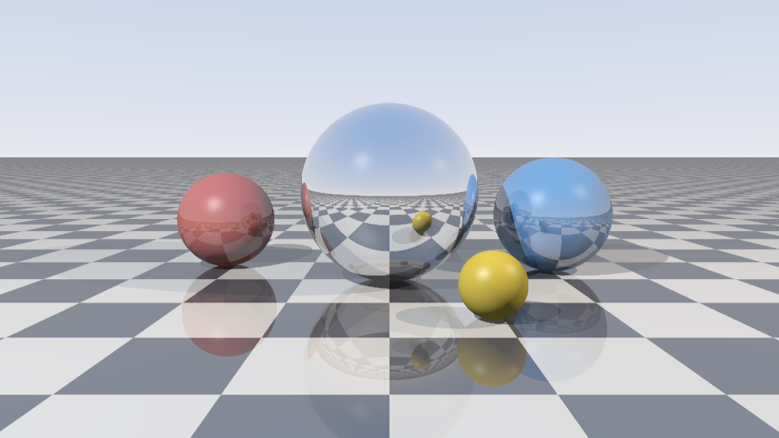

# lumen-rt

A small Whitted-style ray tracer in Python + NumPy. No Pillow, no numba, no C extensions. The PNG encoder is ~30 lines of `zlib` + `struct`.



The usual way to write a ray tracer in Python is a loop over pixels, which is painfully slow. Here every stage works on *all* rays at once: intersections are computed per object as one big array op, the closest hit is an `argmin` over the stack, and shading/shadow rays/reflections run on whichever subset of rays hit each object. Reflections recurse on just the rays that bounced. That gets it to roughly 700k primary rays/sec on my machine, which is enough to render the image above in about 6 seconds.

What it does:

- spheres and infinite planes (with an optional checkerboard)
- multiple point lights, hard shadows
- Blinn-Phong highlights
- recursive mirror reflections with a depth limit
- jittered supersampling for anti-aliasing
- a soft tone map + gamma so highlights don't clip too harshly
- scenes described in plain JSON
- `--preview` draws the render straight into your terminal with truecolor half-blocks

## running it

```
pip install -r requirements.txt
python -m lumen scenes/mirror_balls.json -o renders/mirror_balls.png -W 960 -H 540 -s 8 -d 4
```

```
960x540, 8 spp, depth 4: 5.95s (697k primary rays/s) -> renders/mirror_balls.png
```

A quicker one with the defaults:

```
$ python -m lumen scenes/mirror_balls.json -o renders/small.png
480x270, 4 spp, depth 3: 0.76s (680k primary rays/s) -> renders/small.png
```

Options: `-W/-H` size, `-s` samples per pixel, `-d` max bounces, `--preview` for the terminal version.

## how it works

1. **camera rays.** `primary_rays` builds a camera basis (forward, right, up) from
   `eye`/`target`/`fov` and makes one unit direction per pixel with a `meshgrid`, so the whole
   image is a single `(W*H, 3)` array of rays.
2. **intersection.** each object computes its hit distance `t` for every ray at once.
   spheres solve the ray/sphere quadratic (simplified because directions are unit length,
   taking the far root when the ray starts inside), planes do `dot(p0 - o, n) / dot(d, n)`.
   misses get a huge `FAR` value. stacking those arrays and taking `argmin` gives the nearest
   object per ray.
3. **shading.** rays that miss get a sky gradient. for each object, the rays that hit it are
   pulled out with a mask and shaded together: ambient + Lambert diffuse + Blinn-Phong specular
   per light. normals facing away from the ray are flipped, and the hit point is nudged off the
   surface a bit to avoid shadow acne.
4. **shadows.** for every light, a shadow ray goes from the hit point toward the light, run
   through the same `nearest_hit`. if anything is closer than the light, that light is skipped
   for that pixel. hard shadows only, since lights are points.
5. **reflections.** for reflective materials, the reflected directions are traced by calling
   `shade` again on just those rays with `depth - 1`, and the result is blended in by the
   material's `reflect` amount.
6. **anti-aliasing and output.** with `-s N` the whole image is rendered N times with a
   random sub-pixel offset and averaged. the offset is the same for every pixel in a pass,
   which keeps it vectorised but isn't true per-pixel jitter. the linear result goes through a
   soft tone map and gamma 2.2, then into the hand-written PNG encoder (raw scanlines,
   `zlib`, CRC'd chunks).

## scene files

```json
{
  "camera": {"eye": [0, 1.4, -6], "target": [0, 0.7, 0], "fov": 45},
  "objects": [
    {"type": "plane", "point": [0, 0, 0], "normal": [0, 1, 0],
     "material": {"color": [0.9, 0.9, 0.9], "checker": [0.1, 0.1, 0.1], "reflect": 0.25}},
    {"type": "sphere", "center": [0, 1, 0], "radius": 1,
     "material": {"color": [0.9, 0.9, 0.95], "specular": 1.0, "shininess": 200, "reflect": 0.8}}
  ],
  "lights": [{"position": [-4, 6, -5], "intensity": 0.9}]
}
```

Material fields: `color`, `diffuse`, `specular`, `shininess`, `reflect` (0 to 1), `checker` (planes only).

## tests

```
python -m pytest -q
14 passed in 0.13s
```

They cover the ray/sphere and ray/plane math (including rays starting inside a sphere), the PNG encoder (decoded back and CRC-checked by hand), shadowing, deterministic supersampling, and the CLI end to end.

## layout

```
lumen/
  vec.py      normalize / dot / reflect on arrays of vectors
  scene.py    Sphere, Plane, Light, Camera, Material
  render.py   the actual tracer
  loader.py   json -> Scene
  png.py      dependency-free png writer
  __main__.py cli
```

## what I'd do next

- triangles + a BVH so it can load an OBJ mesh
- soft shadows from area lights (it's mostly just more shadow rays, which the vectorised setup handles well)
- refraction / glass spheres with Fresnel
- move the hot loop to the GPU with CuPy, the code is basically already written for it

MIT licensed.
